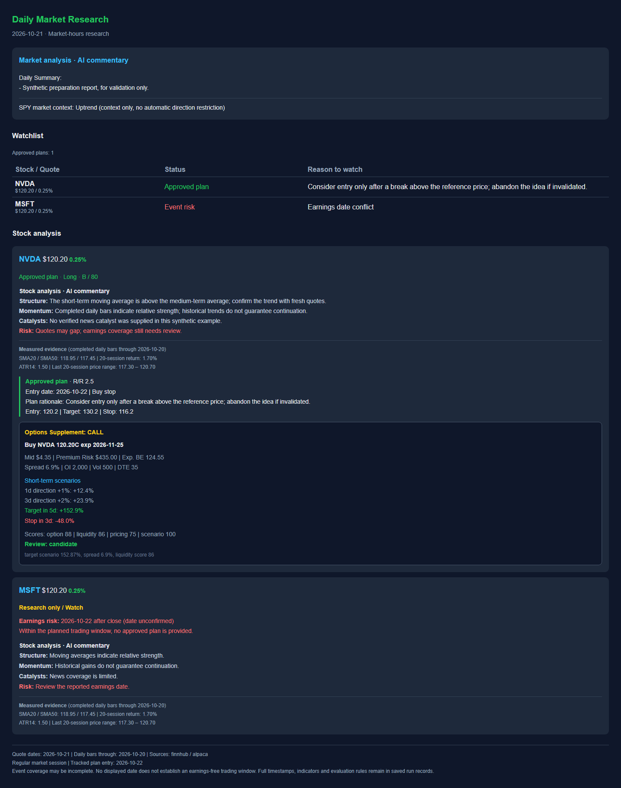
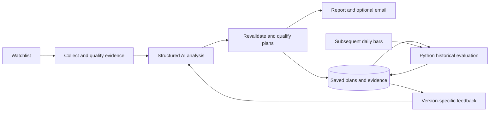

# AI-Assisted Market Research Pipeline

A watchlist becomes an English research report. Qualified stock plans are saved and evaluated later under explicit, versioned rules.

**Stack:** Node.js · Python · PostgreSQL · OpenAI · market-data APIs · GitHub Actions

[](https://github.com/Jial1/market-research-pipeline/actions/workflows/ci.yml)



## Try the offline demo

Install Node.js 22+ and run from this repository's root:

```sh
npm ci
npm start
```

Open `local-data/demo/report.html`; the command prints its full path. The report shows an approved plan with an options supplement and a second stock blocked by an earnings conflict. Inputs are synthetic and fixed to October 2026. No credentials, database, provider/model calls or email are used.

Demo and live reporting share the same qualification, construction and rendering path. Generated files stay under ignored `local-data/`; the screenshot is the only committed preview. Preparation, missing data and unavailable options remain covered by tests.

For historical evaluation and tests, install Python 3.11+:

```sh
python -m venv .venv
# Windows PowerShell: .venv\Scripts\Activate.ps1
# macOS/Linux: source .venv/bin/activate
python -m pip install -r python/requirements.txt
npm run evaluate:demo
npm test
npm run test:python
```

The evaluation demo prints target, gap, ambiguity, expiry and missing-evidence outcomes. It writes no files. These are correctness examples, not measured model performance.

## How it works



The application owns measured indicators, freshness/earnings checks and plan approval. Conditional preparation and options scenarios stay outside stock evaluation. Paid-response checkpoints, atomic storage and uncertain-delivery handling support recovery. The system does not execute trades.

## Review the implementation

| Question | Start here |
|---|---|
| How are responsibilities and recovery organized? | [Architecture](docs/architecture.md), [design tradeoffs](docs/engineering-decisions.md) |
| How are outcomes calculated and shared across languages? | [Evaluation rules](docs/evaluation.md), [data/metric contract](docs/evaluation-contract.md) |
| How can I run and verify it? | [Setup](docs/setup.md), [migrations](docs/database-migrations.md), [verification/release](docs/release.md) |

Useful code entry points are [the workflow](src/reportRun.js), [construction](src/reportBuilder.js), [model validation](src/modelAnalysis.js), [persistence](src/runRecords.js), [pure evaluation](python/evaluation_policy.py) and [the cross-language integration test](test/publicWorkflow.integration.test.js).

## Live operation and scope

Use your own credentials and a dedicated public-project database; follow [setup](docs/setup.md). Run `npm run db:migrate` before jobs. `npm run report:live` saves qualified plans and local HTML; `npm run report:email` explicitly opts into delivery. `npm run evaluate:live` reads later prices and records outcomes.

Finnhub supplies stock quotes/news/earnings, Alpaca supplies calendars/history, and MarketData supplies options. Provider access determines available evidence. Email and options are optional. Discord, interactive research commands, model/provider comparison experiments, broker execution and private deployment tooling are excluded.

Live commands consume provider quota and may incur charges. Hypothetical plan outcomes do not establish portfolio performance. See [limitations](docs/limitations.md) and the current [verification status](docs/release.md).
